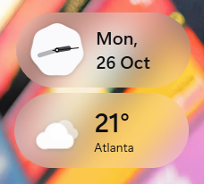

# win_widgets_oneui

Samsung One UI–style clock and weather widgets for the Windows 11 desktop: frosted, translucent pills that sit right on top of your wallpaper, can be dragged anywhere and scaled freely.



## Features

- **Analog clock** with a One UI "cookie" face, plus day and date in your system locale.
- **Current weather** from [Open-Meteo](https://open-meteo.com/) (no API key needed). Location is detected by IP or set by city name. Click the widget to open the full forecast on weather.com.
- **Frosted glass look**: the wallpaper behind each widget is blurred, edges are smooth, multiple monitors and every wallpaper fit mode are supported.
- **Lives on the desktop**: widgets stay below your windows and are hidden from the taskbar and Alt+Tab.
- **Move and scale**: drag to move, <kbd>Ctrl</kbd> + mouse wheel to resize (50–300 %). Positions and sizes are remembered.
- **Themes**: Auto (text colour follows the wallpaper brightness), Light (dark text), Dark (white text).
- **Lightweight**: about 0 % CPU and ~45 MB RAM while idle.

## Install

1. Download the latest zip from [Releases](https://github.com/YevhenVe/win_widgets_oneui/releases):
   - `DesktopWidgets-<version>-win-x64.zip`: self-contained, runs on any Windows 10/11 x64.
   - `DesktopWidgets-<version>-win-x64-net10-runtime.zip`: tiny build for machines with the [.NET 10 Desktop Runtime](https://dotnet.microsoft.com/download/dotnet/10.0).
2. Unzip anywhere, e.g. `%LOCALAPPDATA%\Programs\DesktopWidgets`, and run `DesktopWidgets.exe`.
3. The app isn't code-signed, so SmartScreen may warn on first launch: **More info → Run anyway**.

## Usage

| Where | What |
|---|---|
| Drag a widget | Move it |
| <kbd>Ctrl</kbd> + wheel over a widget | Resize it |
| Click the weather widget | Open the forecast on weather.com |
| Right-click a widget | Refresh weather, set location, scale, lock position, remove widget |
| Tray icon | Add clock / weather, background, theme, weather location, Fahrenheit, start with Windows, exit |

Settings are stored in `%LOCALAPPDATA%\DesktopWidgets\settings.json`.

## Build from source

Requires the [.NET 10 SDK](https://dotnet.microsoft.com/download/dotnet/10.0) on Windows.

```powershell
git clone https://github.com/YevhenVe/win_widgets_oneui.git
cd win_widgets_oneui\src\DesktopWidgets
dotnet run
```

Pass `--preview` (`dotnet run -- --preview`) to show the widgets above all windows while developing.

Publish a self-contained single-file build:

```powershell
dotnet publish -c Release -r win-x64 --self-contained true -p:PublishSingleFile=true -p:IncludeNativeLibrariesForSelfExtract=true -p:DebugType=None -o ..\..\dist\standalone
```

Don't add `EnableCompressionInSingleFile`: the compressed assemblies get unpacked into process memory and nearly double the private footprint. Zip the output instead.

## How it works

- **C# / .NET 10 / WPF**, no third-party packages; Win32 and shell APIs are called via P/Invoke.
- **Blur**: Windows 11's own backdrops don't work here (acrylic turns opaque on inactive windows, the legacy accent blur renders black). Since widgets sit directly on the desktop, the app instead reads every monitor's wallpaper through `IDesktopWallpaper`, composes and blurs it once, and paints the matching slice behind each widget (`Backdrop.cs`).
- **Desktop layer**: `WM_WINDOWPOSCHANGING` is intercepted to keep the windows just above `Progman` (`WidgetWindow.cs`).
- **Small footprint**: software rendering (no Direct3D device), conservative GC, and the working set is trimmed after bursts of work (`MemoryTrim.cs`). The tray icon uses `Shell_NotifyIcon` directly instead of WinForms.

| File | Purpose |
|---|---|
| `WidgetWindow.cs` | Base pill window: frost, drag, scale, z-order, context menu, theme |
| `ClockWidget.cs` | Analog clock and date |
| `WeatherWidget.cs`, `WeatherService.cs`, `WeatherIcons.cs` | Weather data, location and icons |
| `Backdrop.cs` | Wallpaper composition and blur |
| `TrayIcon.cs` | Notification-area icon and menu |
| `Settings.cs` | JSON settings |

## Credits

Weather data by [Open-Meteo](https://open-meteo.com/) (CC BY 4.0). IP geolocation by [ipapi.co](https://ipapi.co/) with [ip-api.com](https://ip-api.com/) as a fallback. Design inspired by Samsung One UI; this project isn't affiliated with Samsung.
